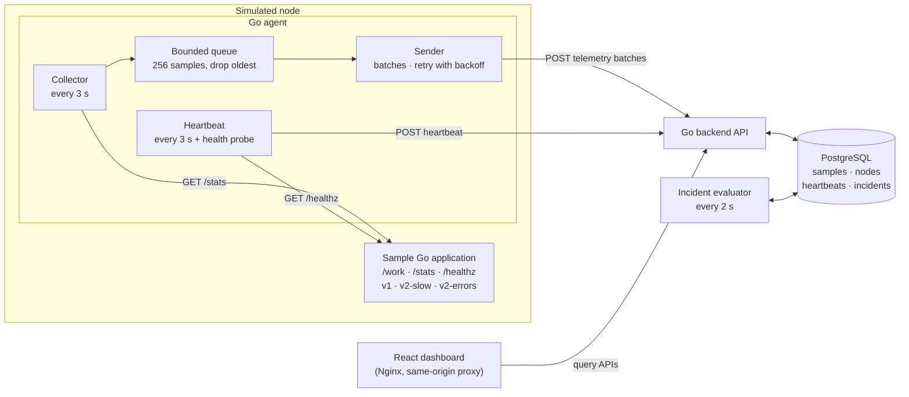

# Pulse

**Did a release make our applications slower or less reliable, and which nodes were affected?**

Pulse is a telemetry and diagnostics platform that answers that question. Agents collect measurements from each monitored application and send heartbeats. A Go backend stores the history in PostgreSQL, detects outages and release regressions, and records the evidence for each incident. A React dashboard lets an engineer trace what changed, when, and in which version.

**Intended user:** an engineer responsible for a fleet of services or devices who has just shipped a release and needs to tell a real regression from noise, a crashed application from a lost agent, and correlation from coincidence.

**Scope:** a local simulation. Each "node" is a small Go application plus a companion agent, run in Docker Compose. Faulty releases are built into the sample application: `v2-slow` adds about 200 ms per request, and `v2-errors` fails every third request. No physical hardware is monitored.

**▶ [Watch the 3-minute demo](https://www.youtube.com/watch?v=XR1ry1PW4iI):** a faulty release is detected, compared against the healthy version, and rolled back.

[](https://www.youtube.com/watch?v=XR1ry1PW4iI)

## Quick start

Requirements: Docker with Compose, and Python 3.11 or later (standard library only).

```sh
python scripts/demo.py
```

The command builds and starts the stack, sends traffic to node-1, and then:

1. shows the healthy baseline;
2. deploys a faulty release;
3. waits for Pulse to open an incident and prints the evidence;
4. compares the two versions;
5. rolls back and waits for recovery.

It always restores the healthy version on exit. Use `--fault errors` for the error release, or `--pause` to step through manually (for presenting or recording). A typical run:

```text
Step 3: Pulse detects the regression
   Incident opened 12 s after deployment: slow responses on node-1, version v2-slow
   Evidence: mean latency above 100 ms in 3 consecutive intervals of at least 5 requests
   Measured intervals: 202 ms, 202 ms, 202 ms
Step 4: compare v1 with v2-slow
           v1:   377 requests,   0.0% errors,     0.6 ms mean latency
      v2-slow:    59 requests,   0.0% errors,   202.2 ms mean latency
Step 5: roll back to v1 and wait for recovery
   Incident resolved 12 s after rollback (three healthy intervals).
```

Then explore:

- the dashboard at http://localhost:3000. Every view is a shareable link; `#/node/node-1?minutes=5` frames a demo run, and `#/compare/node-1` compares the latest release;
- the API at http://localhost:8080;
- the sample application at http://localhost:8081.

Stop with `docker compose down`. Data stays in a named volume; `docker compose down -v` deletes it.

## Screenshots

| Fleet overview | Release comparison |
| --- | --- |
|  |  |

The dashboard design follows established usability and dashboard guidance:

- **Status first.** A live/reconnecting indicator is always visible. Fleet-wide tiles lead with what needs attention, and open incidents appear as alerts at the top of a node's page.
- **Recognition over recall.** Node search replaces paging through about 1,000 test nodes. Version fields suggest the versions actually observed. The comparison view pre-fills the latest regression against the release before it.
- **Context on the chart.** Release changes are drawn as labelled markers and incidents as shaded bands, so cause and effect sit on one timeline. Each incident links straight to a comparison of its release.
- **Accessible encoding.** Status is always an icon plus a label, never color alone, and the data color passes contrast checks in light and dark mode. Charts work with the keyboard and have a table view; touch targets are at least 44 px on phones.
- **Real navigation.** Every view is a link with breadcrumbs and a working back button. Dark mode follows the operating system.

## Architecture



| Component | Code | Role |
| --- | --- | --- |
| Sample application | `cmd/sampleapp` | Real SHA-256 work per request; cumulative counters; built-in faulty versions |
| Agent | `cmd/agent` | Independent collection, bounded queue, batched delivery with retries, heartbeats with application health probes |
| Backend | `cmd/backend`, `internal/backend` | Ingestion, history queries, fleet status, version comparison, incident evaluation, forward-only migrations |
| Dashboard | `web/` | Fleet search and status, node investigation (annotated charts, incidents with evidence), release comparison; polls every 5 s |
| Tooling | `scripts/`, `tests/` | Demo, integration checks, pytest fault scenarios, load and fault-under-load benchmarks |

## How it works

**Retry-safe ingestion.**

- Every sample carries an agent-chosen identity, `(node_id, session_id, sequence)`. The identity is the primary key, so retries never create duplicates.
- Gaps in sequence numbers reveal lost samples.
- A batch is acknowledged only after its transaction commits.
- Each batch is stored with one set-based insert. This made ingestion 2.5–3.3× faster than inserting sample by sample (see [Performance](#performance)).
- Delayed samples are stored at their collection time but never overwrite newer node metadata.

**Bounded buffering.** Collection and delivery run independently, connected by a fixed-size queue.

- During a backend outage the agent keeps collecting and retries with capped, jittered backoff.
- When the queue is full, the oldest waiting sample is dropped and counted. Memory stays bounded, and the newest data, the most useful for detection, is kept.

**Reachability from heartbeats, not history.**

- Agents send a heartbeat every 3 s, independently of telemetry delivery. Late or buffered telemetry therefore never makes a disconnected node look healthy.
- **Agent unreachable** opens after 15 s without contact. An outage of the backend or its database is not counted against agents.
- **Application unavailable** opens after three consecutive failed health probes, which keeps "the application crashed" separate from "the agent went silent".

**Release regressions.**

- Every 2 s the evaluator turns the latest four samples into three interval deltas. They must come from the same application process and version, and each interval needs at least five requests.
- **Opening thresholds:** above 10% errors or 100 ms mean latency in all three intervals.
- **Recovery thresholds:** below 5% errors or 50 ms in three intervals. The gap between the two thresholds prevents flapping.
- Counter resets, version changes and gaps over 10 s invalidate a decision.

**Evidence.** Each incident stores what opened it:

- regressions: the measured intervals and the rule;
- application unavailable: the failed health probes;
- agent unreachable: the last heartbeat and the timeout.

The dashboard shows this in the incident timeline.

**Version comparison.**

- `GET /api/v1/nodes/{id}/compare` compares two versions over separately chosen windows.
- It uses only valid counter deltas within one application process.
- Latency is request-weighted (total latency divided by total requests), not an average of averages.
- Windows without traffic report null rates rather than misleading zeros.
- A difference between versions shows correlation, not proof of cause.

The reasoning behind the three central decisions is in [docs/DESIGN.md](docs/DESIGN.md):

1. stable sample identities;
2. bounded memory versus telemetry loss;
3. heartbeat status versus historical measurements.

## Validation

| Check | What it proves | Command |
| --- | --- | --- |
| Go unit and race tests | Delivery retries, overflow policy, cancellation, comparison math, ingestion helpers, validation | `go test -race ./...` |
| Smoke | Application → agent → PostgreSQL → API, duplicate ingestion, collection-time ordering, version history | `python scripts/smoke.py` |
| Ingestion semantics | First-occurrence wins, delayed samples, equal timestamps, multi-node batches | `python scripts/ingest_semantics.py` |
| Comparison and fleet | Database-backed comparison edge cases; heartbeat-based fleet status | `python scripts/comparison.py`, `python scripts/fleet.py` |
| Fault scenarios (pytest) | Application failure vs agent disconnect, 18 s backend outage with no sample loss and no false alarm, both faulty releases detected with evidence, comparisons, rollback recovery | `python -m pytest -v -s tests/test_scenarios.py` |

Install the test dependency with `python -m pip install -r requirements-test.txt`.

The pytest harness restores the default healthy stack after every test. On failure it attaches Compose state, service logs, incidents and connection-pool counters to the report. Set `PULSE_DIAGNOSTICS_DIR` to also save them as files.

GitHub Actions ([.github/workflows/ci.yaml](.github/workflows/ci.yaml)) runs on every push and pull request:

- vet and race tests;
- the Compose build, including the dashboard production build;
- every check in the table;
- a backend-restart persistence check.

On failure it uploads the diagnostics as an artifact.

## Performance

Measured on one laptop (Intel i7-8665U, 4 cores and 8 threads), with client, backend and database sharing the host. Full method, raw data and limits are in [BENCHMARK.md](BENCHMARK.md).

- **Bottleneck found by instrumentation:** per-sample SQL round trips inside each transaction kept the database connection pool busy. Postgres sessions spent about 70% of their in-transaction time idle, waiting for the backend's next statement. Commit fsync, Go CPU and the load client were not the limit.
- **Fix:** one set-based insert per batch (about 3 statements instead of 65–97).
- **Result** over 45 interleaved, warmed-up trials of three implementations, with zero failed requests and every stored row verified:

  | Concurrent senders | Before (per-node) | After (set-based) | p95 latency before → after |
  | ---: | ---: | ---: | ---: |
  | 1 | 576 samples/s | 1,175 samples/s | 79 → 46 ms |
  | 16 | 2,818 samples/s | 8,000 samples/s | 291 → 92 ms |
  | 32 | 2,641 samples/s | 7,548 samples/s | 896 → 294 ms |

  Paired within each round, set-based ingestion was 2.5–3.3× faster than per-node.

- **Under load:** with up to 128 concurrent synthetic senders, the real agent recorded no retries, drops or sequence gaps, and no false incidents. Detection delay was unchanged: about 10–14 s for release regressions, 7 s for application failure, and 12–15 s for an unreachable agent.

Diagnostics for your own runs:

- the backend serves Go `pprof` and connection-pool statistics on `127.0.0.1:6060` (loopback only);
- `scripts/load.py` and `scripts/ab_benchmark.py` reproduce the throughput experiments;
- `scripts/fault_load.py` reproduces the under-load measurements.

## Limitations and delivery guarantees

**Sample loss.**

- Delivery is at-least-once only while the agent process lives. A crash loses queued samples; there is no disk buffer.
- If an outage outlasts the queue (about 12.8 minutes at default settings), the oldest samples are dropped and counted.
- Batches rejected with a non-retryable HTTP error are discarded and counted.
- Retry and loss counts appear in agent logs, not as live metrics.

**Clock assumptions.**

- Collection timestamps come from the agent's clock. Clocks are assumed roughly synchronized, and timestamps more than five minutes in the future are rejected.
- Heartbeat freshness and incident times use the database clock.
- Agent-unreachable incidents are dated at the timeout: 15 s after the later of the last heartbeat and the start of evaluation.

**Measurement meaning.**

- Counters are cumulative per application process and reset on restart. Only same-process deltas are compared.
- `memory_bytes` is the Go heap allocation, not process, container or host memory.
- Latency is a request-weighted mean per interval, not a percentile.

**Simulation scope.**

- Nodes, versions and faults are simulated, and the workload is synthetic.
- The comparison API covers one node at a time.
- Heartbeats prove contact, not the cause of losing it.
- Version differences establish correlation, not causation.

**Security.**

- Local demo only: fixed credentials, no authentication, no TLS, no retention policy.
- Ports are bound to loopback.

**Benchmarks.** Single shared host, short trials, one real agent; see [BENCHMARK.md](BENCHMARK.md).

## Reference

### API

| Endpoint | Purpose |
| --- | --- |
| `POST /api/v1/telemetry/batches` | Accept 1–100 samples (1 MiB limit). Returns `202` with the count newly inserted, after commit. |
| `POST /api/v1/nodes/{id}/heartbeat` | Record contact and an optional `application_healthy` probe result |
| `GET /api/v1/fleet?after=<id>&q=<text>&attention=1` | Status, version, Go heap, last contact; 100 nodes per page, including heartbeat-only nodes. `q` is a case-insensitive ID search; `attention=1` keeps nodes with an open incident or no recent heartbeat. |
| `GET /api/v1/fleet/summary` | Node counts by status for the whole fleet |
| `GET /api/v1/nodes?after=<id>` | Current version and latest collection time; 100 per page |
| `GET /api/v1/nodes/{id}/metrics?from=&to=&limit=` | Historical samples. RFC3339 window of at most 24 h, start-inclusive; `limit` up to 1000 (default 100). |
| `GET /api/v1/nodes/{id}/incidents` | Latest 100 incidents with kind, version, open and resolve times, and evidence |
| `GET /api/v1/nodes/{id}/compare` | `baseline_version`, `baseline_from`, `baseline_to`, `candidate_version`, `candidate_from`, `candidate_to`: requests, errors, error rate, weighted latency, observed intervals and seconds |
| `GET /healthz`, `GET /readyz` | Liveness; database readiness |

Sample batch:

```json
{"samples":[{"node_id":"node-1","session_id":"unique-agent-session","sequence":1,"collected_at":"2026-10-21T12:00:00Z","version":"v1","app_process_id":"process-1","requests":10,"errors":0,"total_latency_ms":15.2,"memory_bytes":1048576}]}
```

### Configuration

| Service | Variable | Default |
| --- | --- | --- |
| Sample application | `LISTEN_ADDR`, `APP_VERSION` | `:8081`, `v1` (`v2-slow` and `v2-errors` are the faulty releases) |
| Backend | `LISTEN_ADDR`, `DATABASE_URL`, `DEBUG_ADDR` | `:8080`, local Postgres URL, unset (Compose sets `:6060`) |
| Agent | `NODE_ID`, `APP_URL`, `BACKEND_URL` | `node-1`, `http://localhost:8081`, `http://localhost:8080` |
| Agent | `COLLECT_INTERVAL`, `FLUSH_INTERVAL`, `QUEUE_CAPACITY`, `BATCH_SIZE` | `3s`, `3s`, `256`, `32` |

The backend applies six numbered, forward-only migrations at startup, under a transaction and an advisory lock. Samples from before process identities were added have an empty `app_process_id` and are excluded from deltas.

To try a faulty release by hand, run Compose with `APP_VERSION` set:

```sh
APP_VERSION=v2-slow docker compose up -d --no-deps sampleapp
```

In PowerShell, set it first with `$env:APP_VERSION='v2-slow'`. Then run `docker compose up -d --no-deps sampleapp` without `APP_VERSION` to roll back.

## Development

```sh
go test ./... && go vet ./... && go build ./...
docker run --rm -v "$PWD:/app:ro" -w /app golang:1.27.3 go test -race ./...   # race detector without local CGO
npm ci --prefix web && npm run dev --prefix web                                # Vite dev server, proxies the API to :8080
npm run build --prefix web                                                     # type-check and production bundle
```

The race command uses `$PWD`. On Windows PowerShell, use `${PWD}`, or the full path such as `C:\code\pulse`.

Repository layout:

```text
cmd/            sample application, agent, backend entry points
internal/       backend (ingestion, queries, incidents, migrations), telemetry model, HTTP server
web/            React/TypeScript dashboard and Nginx configuration
scripts/        demo, integration checks, load and fault benchmarks
tests/          pytest fault scenarios and failure diagnostics
benchmarks/     raw benchmark results and patches to rebuild earlier ingestion variants
docs/           design notes and screenshots
```
